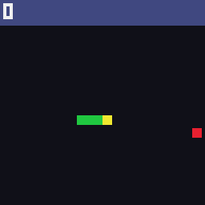
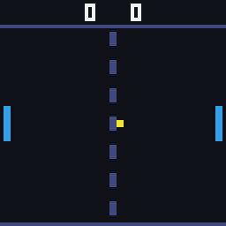
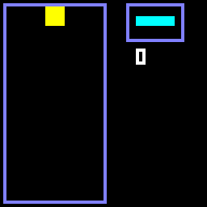
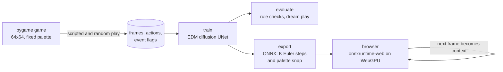

# LucidWorldModel

A game with no game code. Every frame is generated by a world model I trained.

<p>



</p>

LucidWorldModel trains small action-conditioned diffusion world models on Snake, Pong and Tetris, exports them to ONNX and runs them in the browser on the GPU through WebGPU. The page ships no game logic: at every tick the model reads the last few frames and your key press, then generates the next frame. Snake, the walls, the ball, the score and the line counter exist only in what the model learned.

The GIFs show the scripted agent playing inside the shipped models from a fresh game start, cut before the first broken rule. How long play typically stays clean is in the table below.

## Results

Chrome on an M5 Max. "Clean steps" is the median number of ticks before the first broken game rule while a scripted agent plays inside the model (100 rollouts, 10% random actions), checked by parsing every generated frame back into game state.

| Game | Tick rate | Sampler steps | ms per frame | One-step rule pass | Clean steps (median) | Target |
| --- | --- | --- | --- | --- | --- | --- |
| Snake | 10 Hz | 8 | 56 | 99.85% | **640** (64 s) | 500 |
| Pong | 30 Hz | 3 | 21.5 | 99.6% | 175 (6 s) | 900 |
| Tetris | 10 Hz | 8 | 56 | 96.6% | 22 (2 s) | 600 |

Snake meets its target. Pong scores a point a few ticks before the ball reaches the paddle and often skips the match-end flash, which is rare in the data. Tetris gets more than half of its line clears wrong; a line clear is a whole-board operation that this small convolutional model has not learned. The browser output matches PyTorch on 100% of pixels for all three games.

## How it works



1. **Games.** Each game is a small pygame program that renders natively at 64x64 with a fixed palette. The designs follow one rule: everything that affects the future must be visible in the last $N$ frames (no hidden timers, integer velocities, memoryless randomness, visible deaths that restart on their own). A script hashes every (context, action) pair in the data to check it.
2. **Data.** 500k steps for Snake and 1M each for Pong and Tetris, from sticky random play and scripted agents with noise, collected on a laptop CPU in under a minute.
3. **Model.** A pixel-space EDM diffusion UNet (5.65M parameters, 3.5 GFLOPs per call) predicts the next frame. The last $N$ frames ($N = 4$, or 8 for Tetris) are concatenated on the channels, and the actions and noise level condition every block through adaptive group norm. Training adds noise to the context frames so the model tolerates its own imperfect frames.
4. **Export.** One static ONNX graph per game and step count holds the whole sampler: $K$ Euler steps and a snap of every pixel to the game's palette.
5. **Browser.** React and onnxruntime-web run one graph call per tick and draw the result. Each game starts from a recorded real opening; every frame after that is generated.

## What I learned

- **Random draws need more sampler steps than deterministic rules.** With the usual few-step schedule ($K = 3$, $\sigma_\text{min} = 0.002$, $\rho = 7$), new food in Snake never appeared: the sampler averages over the roughly 200 free cells, and the average snaps to no food. The schedule spent two of its three steps at noise levels where nothing is left to decide. Raising $\sigma_\text{min}$ to 0.3 (the palette snap cleans up the rest) and using $K = 8$ fixed it.
- **Start the sampler at the last frame, not at zero.** Training inputs are $y + \sigma\varepsilon$ with dark frames, and with $\sigma_\text{max} = 5$ over 12,288 values the image mean of the input gives away the frame's mean color. Starting from pure zero-mean noise told the Pong model the frame was mid-grey, so it drew its full-screen match-end flash on most ticks (29% pixel accuracy despite a low training loss). Starting at $x_0 = o_t + \sigma_\text{max}\varepsilon$ fixed it with no retraining and raised Snake's clean steps from 360 to 640.
- **onnxruntime-web 1.31.1's WebGPU convolution is wrong for 15 or 27 input channels.** The model's first layer sees $3(N + 1)$ channels, exactly 15 for Snake and Pong and 27 for Tetris. The export pads it with zero channels to a multiple of 4, which is exact and costs about 1 ms. A latency benchmark on zero inputs missed it; only a parity check with real inputs caught it.
- **Set $\sigma_\text{data}$ to the pixel RMS, not the standard deviation.** EDM's preconditioning assumes zero-mean data. Mostly dark frames have a standard deviation of 0.27 but an RMS of 0.80, and using the standard deviation left the network target with a second moment near 9 instead of 1.

## Running it

Requirements: [uv](https://docs.astral.sh/uv/), Node 20.19+ or 22.12+, and Chrome or Edge 113+ (or another browser with WebGPU). Trained models are not in the repo, so the web app needs a trained and exported run.

```sh
uv sync
uv run python -m scripts.games.play --game snake              # play the real game; --record saves human play
uv run python -m scripts.collect --game snake --out data/snake  # Pong and Tetris used --steps 1000000
uv run python -m scripts.check_observability --game snake --data data/snake
uv run python -m scripts.train --game snake --name base       # about 4 h on one RTX A6000
uv run python -m scripts.evaluate --run runs/snake/base --steps 8 --sigma-min 0.3 --rho 3
uv run python -m scripts.export_game --run runs/snake/base --steps 8 4 2 --sigma-min 0.3 --rho 3
cd web && npm ci && npm run dev                               # http://localhost:5173
```

In the app, arrows or WASD steer, Space hard-drops in Tetris, P pauses and R restarts. The sampler-steps buttons switch between the exported graphs mid-game. `/?parity` compares the browser's output with PyTorch, and `/?bench` times random-weight graphs.

## Layout

```
scripts/games/   snake.py, pong.py, tetris.py (rules, rendering, extract, rule checks, scripted policy), play.py
scripts/         collect.py, check_observability.py, model.py, train.py, evaluate.py, export_game.py, export_onnx.py
sbatch/          Slurm job script for the GPU cluster
tests/           pytest suite
web/             React, Vite and Tailwind app
data/, runs/     datasets and training runs (not tracked)
```
